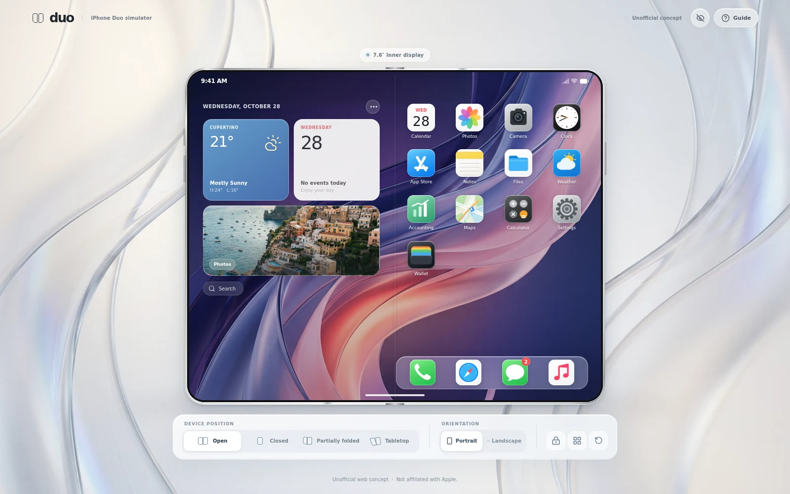
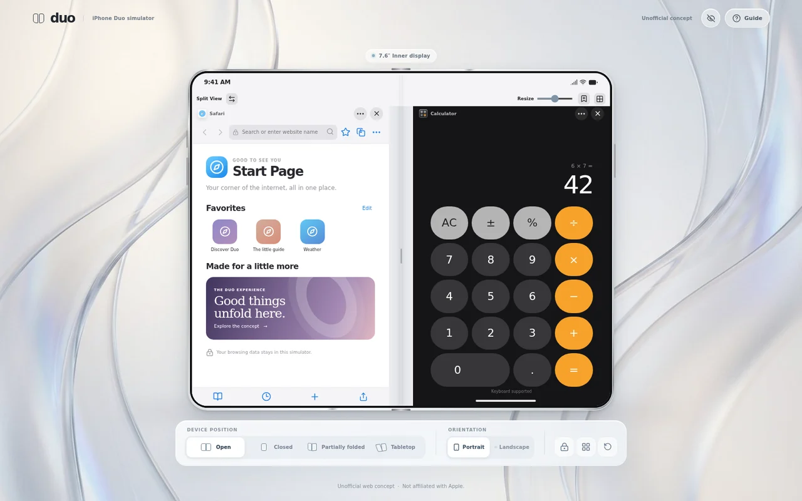
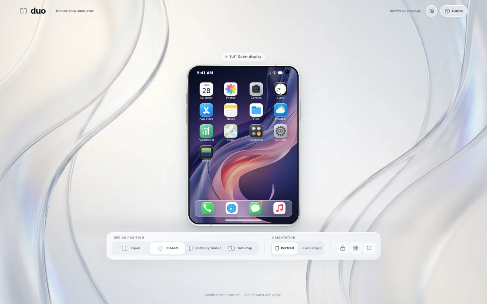

<h1 align="center">iPhone Duo Web Simulator</h1>

<p align="center">
  <strong>Two screens. One browser. A new way to explore.</strong><br />
  An interactive foldable phone concept, built for the web.
</p>

<p align="center">
  <a href="https://hoseinsedaqat.github.io/iPhone-Duo/"><strong>Explore the live demo</strong></a>
  &nbsp;·&nbsp; <a href="#key-features">Features</a>
  &nbsp;·&nbsp; <a href="#screenshots">Screenshots</a>
  &nbsp;·&nbsp; <a href="#run-locally">Run locally</a>
  &nbsp;·&nbsp; <a href="#project-structure">Architecture</a>
</p>

<p align="center">
  
  
  
  
</p>



**iPhone Duo Web Simulator** is an interactive, iOS-inspired foldable phone concept built with React and TypeScript. Switch between a spacious inner display and a compact outer display, open interactive app concepts, and explore multitasking directly in your browser—no account or installation required.

> [!IMPORTANT]
> This is an **unofficial, independent concept**. It is not an Apple product or an iOS emulator, does not run the real Safari engine, and is not affiliated with Apple.

## Key features

| Experience | What you can explore |
| --- | --- |
| **Two display layouts** | Move between an inner display inspired by the 7.6-inch class and an outer display inspired by the 5.4-inch class. |
| **Flexible device poses** | Choose open, closed, partially folded, or tabletop; switch between portrait and landscape. The poses are visual approximations, not a physical 3D hinge simulation. |
| **Split View** | Open two app windows side by side, resize or swap them, and save a pair. Two independent Safari-inspired windows are supported. |
| **Interactive app concepts** | Explore 17 app experiences, including Safari, Accounting, Calculator, Notes, Calendar, Camera, and Settings. |
| **Personalization** | Change the theme, wallpaper, text size, selected accessibility options, widget choices, and icon order. |
| **English and Persian** | Switch to a Persian right-to-left layout and calendar; some demo copy and sample data remain in English. |
| **Local-first PWA** | Keep simulator data in your browser and use the built-in experience offline after the initial online visit and service-worker installation. |

## Screenshots

<table>
  <tr>
    <td width="50%"></td>
    <td width="50%"></td>
  </tr>
  <tr>
    <td align="center"><strong>Split View</strong><br />Two interactive app windows on the inner display.</td>
    <td align="center"><strong>Outer display</strong><br />A compact layout when the device is closed.</td>
  </tr>
</table>

*Screenshots are captured from this simulator; device dimensions and folding poses are illustrative.*

## Apps at a glance

- **Everyday tools:** Calculator, Calendar, Clock, Notes, Photos, Camera, and Files.
- **Explore and personalize:** Safari-inspired browser, Settings, Weather, Maps, and App Store concept.
- **More to try:** Accounting, Messages, Phone, Music, and Wallet concepts.

The **Accounting** demo supports transactions, categories, multiple sample accounts, filters, and search. Monetary values are stored as integer USD cents and totals use `BigInt` rather than floating-point arithmetic. It is a local demonstration—not financial advice or a bank connection.

The **Safari-inspired browser** offers tabs, independent windows, history, bookmarks, editable favorites, and internal demo pages. External sites only display where embedding is allowed; the sandboxed iframe has scripts disabled, so many sites will not work. Search is simulated and does not silently send queries to a search provider.

## Run locally

### Requirements

- [Node.js](https://nodejs.org/) 20 or later
- npm

```bash
git clone https://github.com/hoseinsedaqat/iPhone-Duo.git
cd iPhone-Duo
npm ci
npm run dev
```

Open the URL printed by Vite, normally `http://localhost:5173`. To build and preview the production version:

```bash
npm run build
npm run preview
```

The development and preview servers bind to `0.0.0.0` for remote preview support. Do not expose a development server to untrusted networks.

## How to explore

1. **Choose a pose.** Use the controls below the device to switch displays, positions, and orientation. Hide the control panel with the eye button if you prefer.
2. **Open an app.** Select an icon, then use the home indicator to return Home. On the Home Screen, the indicator opens recent apps. Drag icons to reorder them; press and hold or right-click for more options.
3. **Try Split View.** In an app, open its **•••** menu, choose **Open in Split View**, and select a second app. Swap, resize, save, or close the pair. A reserved area keeps the central hinge clear.
4. **Make it yours.** Explore Settings and the widget menu for themes, wallpapers, language, accessibility options, and layout choices.
5. **Start fresh when needed.** The reset control asks for confirmation before removing this origin's simulator data and restoring the sample data.

## Privacy, safety, and limitations

- **Your data stays local.** Settings, icon order, and widget choices use `localStorage`; app data such as notes, transactions, browser history, calendar events, and captured photos use IndexedDB via Dexie. The project has no backend and does not sign in to Apple services. Browser storage can be cleared, restricted, or unavailable.
- **Camera access is optional.** The Camera requests explicit browser permission before using a camera. It requires a supported browser, a secure context or localhost, and an available device; captured photos are stored locally.
- **This is not device security.** The optional demo passcode is `1234`; it does not authenticate a user or protect data. Never enter real passwords or sensitive financial information.
- **Several services are simulated.** Messages are not sent; phone calls, payments, native app installation, and music playback are not provided. Network and battery indicators do not control or report real hardware.
- **The hardware is an approximation.** Display sizes, CSS perspective, and poses are illustrative. The two halves are not an articulated 3D model, and browser pixels are not calibrated hardware dimensions.

## PWA and offline use

On a secure origin (or localhost), the production build can be installed as a progressive web app. After one successful online visit and service-worker installation, the shell, artwork, built-in app chunks, and internal browser demo pages are available offline. External websites and camera access remain subject to network and browser restrictions. A new build requires an online visit to install its updated cache.

## Deploy to GitHub Pages

The included workflow builds and deploys from the `test` branch. A repository administrator must set **Settings → Pages → Build and deployment → Source** to **GitHub Actions**. Once enabled, pushes to `test` trigger the workflow; check that the deployment succeeds before visiting the [project site](https://hoseinsedaqat.github.io/iPhone-Duo/).

The workflow gets its base path from GitHub Pages. To build or preview a project site manually under `/iPhone-Duo/`:

```bash
DUO_BASE_PATH=/iPhone-Duo/ npm run build
DUO_BASE_PATH=/iPhone-Duo/ npm run preview
```

Without `DUO_BASE_PATH`, the app builds for `/`. The manifest and service worker stay within the selected deployment scope. Each browser origin has its own local data.

## Testing

```bash
npm run lint                 # ESLint
npm run test                 # Vitest + React Testing Library
npx playwright install chromium
npm run test:e2e             # desktop Chromium + mobile/touch emulation
npm run test:offline         # production PWA offline behavior
npm run test:pages           # project-site subpath and offline updates
npm run build                # TypeScript + Vite production build
```

Playwright may also need system dependencies: `npx playwright install-deps chromium`. Set `PLAYWRIGHT_CHROMIUM_EXECUTABLE_PATH` to use an existing Chromium executable if needed. Mobile browser tests are emulation, not a claim of physical-device coverage.

## Built with

| Layer | Technology |
| --- | --- |
| Interface | React 19, TypeScript, custom CSS, Tailwind utilities |
| State and motion | Zustand, Framer Motion |
| Local database | IndexedDB and Dexie |
| Build and offline | Vite, web app manifest, service worker |
| Tests | Vitest, React Testing Library, Playwright |

## Project structure

```text
src/
├── app/          # site shell and device controls
├── apps/         # app registry and lazy-loaded app experiences
├── components/   # shared icons and UI components
├── device/       # device frame and pose simulation
├── persistence/  # Dexie schema, sample data, and reset
├── styles/       # responsive layouts and visual refinements
├── system/       # Home Screen, window manager, overlays, and state
└── utils/        # currency, calculator, calendar, time, and i18n helpers

e2e/              # desktop, mobile, offline, and Pages browser tests
docs/             # screenshots and badges used in this README
public/           # wallpaper, icons, artwork, manifest, and service worker
```

## Design references

The project takes inspiration from these resources without bundling Apple's models, design-kit files, or proprietary fonts:

- [Apple Newsroom — Apple unveils iPhone Duo](https://www.apple.com/newsroom/2026/09/apple-unveils-iphone-duo/)
- [Apple Human Interface Guidelines — Designing for iPhone Duo](https://developer.apple.com/design/human-interface-guidelines/designing-for-iphone-duo)
- [Apple Design Resources](https://developer.apple.com/design/resources/)
- [GSMArena iPhone Duo photo gallery](https://www.gsmarena.com/apple_iphone_duo_fold-pictures-13804.php) and the independent [iPhone Duo Fold Preview](https://iphone-duo-tawny.vercel.app/) for visual inspiration.

The wallpaper, travel image, and glass backdrop were generated for this concept; launcher icons are original SVG artwork using familiar app metaphors. Screenshots in this README show the actual web simulator.

## License and attribution

No license file is currently included in this repository; do not assume permission to reuse or redistribute its code or assets. iPhone, iOS, Safari, and Apple are trademarks of Apple Inc. This independent project is not affiliated with or endorsed by Apple.
